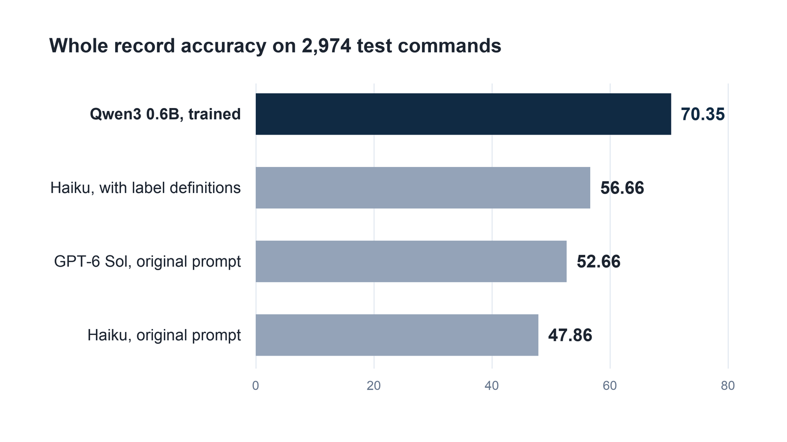

# I Fine Tuned a 0.6B Model to Beat Claude Haiku and GPT-6 Sol at Labeling. Better Instructions Recovered Only 9 of 22 Points

*On 2,974 voice commands, training beat Claude Haiku and GPT-6 Sol given the same prompt. Then I tested how much better instructions could recover for Haiku.*



*Chart of the Table 1 results. Image by author.*

My 0.6 billion parameter model labeled 70.35 percent of voice commands exactly right. Parameters are the numbers that training adjusts inside a model. A prompted Claude Haiku 5.5 managed 47.86 percent, where a prompt is the written instructions sent with every record. A later GPT-6 Sol pass, given the same prompt, reached 52.66 percent.

That looked like a win for training, but it left a problem with my comparison. I had given Haiku a list of allowed label names without saying what each one meant.

I added one line of meaning for each label name, such as `alarm_set`. Haiku then averaged 56.66 percent over three passes. Better instructions recovered 8.80 percentage points of the original 22.50 point gap, and the trained model still led by 13.69 points. I had already seen the original test results, so this is not a clean test. It needs checking on new data.

Researchers have asked a version of this question. The [propella-1 paper](https://arxiv.org/abs/2602.12414) by Maximilian Idahl and colleagues describes small models trained to annotate documents. Its abstract says the 4 billion parameter version "achieves higher agreement than much larger general-purpose models" when another large model's labels are treated as the answer key. That is a claim about documents, and the answer key comes from a model, not from people. I wanted to see the same question on public data with human labels, at a size I could run myself, with every cost counted.

Annotation here means attaching fixed fields to a record, such as the topic and urgency of a message. A prompted model does this by reading the same instructions again on every record. In my test those instructions took 1,052 tokens, and the average record was about 7 words. A token is a short chunk of text, usually a word or part of a word, and API prices are set per token.

I compared Claude Haiku 5.5 and GPT-6 Sol, each given the same fixed prompt, with Qwen3 0.6B, an open model trained on 11,514 labeled examples. I then ran Haiku again with label definitions added to its prompt.

The data is voice assistant commands, not support tickets, so the result shows what happened on this task and nothing wider. I have saved the code, predictions, and cost logs for a companion repository. https://github.com/abduldattijo/structured-annotation-small-model

## What exactly did the models have to produce?

The task uses [MASSIVE](https://arxiv.org/abs/2204.08582), a dataset of voice assistant commands released by Amazon. I used its English part, which has 11,514 training commands to learn from, 2,033 development commands for choosing settings, and 2,974 test commands held back for the original comparison. The later GPT-6 Sol and label definition checks used that already opened test split. The [dataset page](https://huggingface.co/datasets/AmazonScience/massive) lists the license as CC BY 4.0, and its card describes the labels as expert generated.

Every command gets three fields. Take "wake me up at five am this week". The scenario is `alarm`, which is the broad area. The intent is `alarm_set`, which is the specific request. The slots are the pieces of the text that fill in the request, here the time "five am" and the date "this week".

The dataset has 18 scenarios, 60 intents, and 55 slot types. Every intent name starts with its scenario name, so the two fields are not independent. If a model gets the intent right, the scenario follows almost for free.

I scored with strict matching. A record counts as right only when the scenario, the intent, and every slot type and value match the human label exactly. I call this whole record accuracy. A reply that cannot be read as the requested format counts as wrong.

## How were the systems set up?

The prompted system is Haiku 5.5 with reasoning turned off, so it answers straight away without thinking first, and a limit of 400 reply tokens. The prompt lists all 18 scenarios, 60 intents, and 55 slot types. It tells the model to copy slot values word for word from the text and shows three example records. Haiku costs [10 US cents per million input tokens and 50 US cents per million output tokens](https://www.anthropic.com/claude/haiku).

The additional pass used [OpenAI's GPT-6 Sol](https://developers.openai.com/api/docs/models/gpt-6-sol) with that same prompt, which was frozen, meaning fixed before the test run and never changed after. Its reasoning effort was set to `none`, and its reply limit was 200 tokens. No reply hit that limit. It was one pass, added after the original Haiku results were known, with no prompt tuning for GPT-6 Sol. The model returned no unreadable replies.

I chose that prompt on 300 development commands before touching the test set. Three examples scored 44.7 percent whole record accuracy. A version with 18 examples scored 42.7, and one with 36 scored 43.3, at more than twice the cost. The gaps are small enough to be noise on 300 records, so I kept the cheapest prompt.

The small system is Qwen3 0.6B with LoRA. [LoRA](https://arxiv.org/abs/2106.09685), short for low rank adaptation, is like sticking small notes into the margins of a textbook instead of reprinting the book. The original parameters stay frozen, and training only adjusts about 10 million extra numbers. Here is the setup I used.

```python
cfg = LoraConfig(r=16, lora_alpha=32, lora_dropout=0.05,
                 target_modules="all-linear", task_type="CAUSAL_LM")
# 3 passes over 11,514 training records, batches of 32, learning rate 0.0002
# 1,080 training steps, about 20 minutes on a Colab T4 GPU
```

After training, the small model needs no instructions at run time. Its prompt is essentially only the command text, because the label list and the conventions were learned from the training records. Its reply is also JSON, a plain text format for structured data, and it is decoded greedily, which means it always picks the most likely next token.

Training and prompting vary in different ways. Training has random starting points, so I trained three times with seeds 0, 1, and 2. Haiku can answer the same input differently each time, so I ran both its original prompt and its later definition prompt three times on the full test set. GPT-6 Sol had one pass. A seed is just the number that fixes the random choices.

## Did the small model look like a winner at the start?

No. A pilot of 50 development commands was meant to check that the pipeline worked, not to rank anything. Haiku got 46 percent whole record accuracy. A Qwen model trained on only 1,000 records for one pass got 14 percent.

That pilot is why I treated the full training run as a real question and not a foregone conclusion. The full run used all 11,514 training records and three passes. The jump from 14 percent to about 70 percent shows how much more training mattered here, with both more records and more passes.

## What happened on the test set?

I asked each system to label all 2,974 test commands. The table shows how often each output field matched the human label. Higher is better. Scenario and Intent count the records where that one field is right, and Slots exact counts the records where the whole slot list is right. The definition prompt passes were a later follow up on the same test records.

| System | Whole record runs (percent) | Mean whole record | Scenario | Intent | Slots exact |
|---|---|---:|---:|---:|---:|
| Qwen3 0.6B with LoRA | 69.91, 70.85, 70.31 | 70.35 | 91.22 to 91.46 | 88.16 to 88.50 | 76.50 to 77.64 |
| Claude Haiku 5.5, prompted | 47.78, 47.92, 47.88 | 47.86 | 87.39 to 87.49 | 82.48 to 82.78 | 55.88 to 56.42 |
| GPT-6 Sol, original prompt | 52.66 | 52.66 | 90.22 | 85.78 | 59.58 |
| Claude Haiku 5.5, with label definitions | 56.72, 56.36, 56.89 | 56.66 | 89.41 to 89.68 | 85.27 to 85.54 | 64.12 to 64.49 |

*Table 1. Accuracy in percent on the 2,974 MASSIVE English test commands. GPT-6 Sol has one run; the other rows have three. The last row was added after I had seen the other results. Table by author.*

The small model led the original Haiku prompt by 22.50 points on whole records. GPT-6 Sol improved on that prompt by 4.80 points, yet still trailed the small model by 17.69. Adding definitions to Haiku's prompt recovered 8.80 points relative to its original result. The remaining gap to Qwen was 13.69 points.

The narrow ranges describe variation on these same test items, and they say nothing about other datasets. GPT-6 Sol has no repeat range.

Looking at the same records side by side helps. Using seed 0 and the first Haiku pass, both systems were right on 1,254 records and both were wrong on 728. Qwen alone was right on 825, and Haiku alone on 167. Haiku is not simply a weaker copy of Qwen, but it loses far more often than it wins.

## Where did the prompted model lose its points?

The gap has two parts, and the first is easy to guess. Haiku picks the wrong intent more often. I sorted each wrong record by its first mistake, using seed 0 for Qwen and the first pass for Haiku.

| Reason the record was wrong | Qwen3 0.6B | Haiku 5.5 |
|---|---:|---:|
| Wrong scenario or intent | 352 | 508 |
| Right intent, different slot types | 300 | 584 |
| Right intent, same slot types, different values | 111 | 154 |
| Right intent, slots added where none belong | 69 | 165 |
| Right intent, no slots where some belong | 63 | 133 |
| Reply could not be read as the requested format | 0 | 9 |
| Total wrong records | 895 | 1,553 |

*Table 2. Counts of wrong test records by first mistake, out of 2,974 records per system. Image by author.*

The second part is bigger than I expected, and it sits in the slot rows. Haiku chose different slot types far more often. Some of those choices look reasonable, though I did not measure that. They were wrong only against this dataset's habits.

Here is a clear case. In the test labels, the slot type `media_type` covers news sources such as "washington post" and "new york times", and also words such as "tweet". Haiku usually called a news source `news_topic`. Across the 2,974 test commands the labels contain `media_type` 128 times, and Haiku wrote it just 9 times in its first pass.

Qwen, which learned the dataset's habit from its training records, averaged a score of 0.835 on that type across its three runs, against 0.058 for Haiku across its three passes. That score is called slot F1, and it combines how many of the true slots were found and how many of the guessed slots were right, and higher is better. The original prompt told Haiku the allowed slot types but did not define them. That omission became the next thing to test.

The intent mistakes follow the same pattern. The dataset has an intent called `general_quirky` for odd or unclear commands, and 169 test commands carry it. Haiku was exactly right on about 22 percent of them and Qwen on about 56 percent. Haiku often treated such commands as questions, and sent "describe the new football game rules" to `qa_definition`.

Two more failures are specific to prompting. In the three passes, Haiku returned 9, 12, and 7 replies that were chat messages and not data. For the two word command "user friendly", it answered by asking what I wanted done with the phrase. Qwen produced no unreadable replies in any run. Haiku also changed its result between passes on 212 records, which is 7.1 percent of the test set, even though the overall score barely moved.

## What happened when I defined the labels?

I wrote a one line meaning for each of the 60 intents and 55 slot types, using example texts and slot values from the training split. For instance, `media_type` now includes a news outlet, website, social network, tweet, or audiobook. I kept Haiku, its three original examples, its 400-token reply limit, and the scoring code the same. The longer label descriptions were the prompt change.

To control cost, I used prompt caching for the test runs, which lets the API reuse an unchanged prompt at a lower price. The original prompt's separate cached pass scored 47.88 percent, close to its three uncached passes, but caching was not repeated as a controlled factor in the follow up.

This was a follow up prompted by the original test errors. The test split had already been opened, so I used 300 development commands to compare versions and froze the prompt before the follow up test runs. The original prompt scored 44.7 percent on those development commands. My first definitions scored 52.0 percent.

After seeing that version confuse some word meaning questions with `general_quirky`, I revised only that definition; version two scored 53.3 percent. I chose version two and made no further changes.

On the test commands, the frozen definition prompt scored 56.72, 56.36, and 56.89 percent whole record exact, or 56.66 percent on average. Unreadable replies did not go away, with 11, 9, and 11 across the three passes. Slot exact accuracy rose from about 56 percent with the original prompt to about 64 percent. In a paired comparison of one cached pass from each prompt, the definitions corrected 422 records the original prompt missed, while the original prompt got 159 records the definitions missed. That is a net gain of 263 exact records in that pass.

Definitions recovered about 39 percent of the original 22.50 point gap, but they did not erase it. This result supports defining labels before deciding to train a model. It does not prove which individual definition caused the gain, because the prompt also became longer and the definition idea came from inspecting the original test failures. Another dataset would need its own definitions and evaluation.

## What did the systems cost, and how fast were they?

I measured the Haiku bill from the token counts the API returned. For the small model, I measured time on the GPU. A GPU is the graphics chip that does the heavy math. I used a T4, a modest GPU that Google Colab rents out.

| Measurement | Haiku 5.5, original prompt | Haiku 5.5, label definitions | GPT-6 Sol, original prompt | Qwen3 0.6B with LoRA |
|---|---:|---:|---:|---:|
| Bill for the 2,974 test records | 37 US cents (uncached), 9.3 US cents (cached) | about 13.6 US cents (cached) | 4.56 US dollars (uncached) | none per record |
| Cost per 10,000 records, from the figures above | 1.25 US dollars, or 0.31 US dollars cached | 0.46 US dollars cached | 15.34 US dollars | about 4 minutes of T4 time |
| One time cost | none | writing the definitions | none | training, 19 to 21 minutes per seed, plus 11,514 labeled records |
| Median time for one request | 1.0 second | not measured | not measured | 0.96 to 1.02 seconds |
| Records labeled per second in batches | not measured | not measured | not measured | 38 to 40 |
| Memory on the GPU | not applicable | not applicable | not applicable | 1.8 GB serving, 7.4 GB training |

*Table 3. Costs and speed. API figures come from the token counts each API reported and the published prices. Qwen figures come from timed runs on one T4. Cached figures leave out the first request that creates the cache, whose charge was not recorded. Image by author.*

Caching deserves a note. [Prompt caching](https://platform.claude.com/docs/en/build-with-claude/prompt-caching) lets the API reuse a long, unchanged instruction block at a lower price. Here, each cached request read 1,036 tokens at the cheap rate and only about 16 tokens at the full rate. The cached pass scored 47.88 percent, inside the range of the uncached passes.

The later GPT-6 Sol pass cost 4.56 US dollars for 2,974 records, or about 15.34 US dollars per 10,000 at the token counts it actually used. It used no prompt caching. The three cached Haiku passes with definitions recorded about 13.6 US cents each, or about 46 US cents per 10,000. Those figures exclude one request per pass that primed the cache, because the script did not add its charge to the cost counter. The two 300-command development checks for the definitions recorded about 16.1 US cents together.

A cached Haiku bill and an uncached GPT-6 Sol bill are not a like for like comparison, so I state the difference.

The single request speed is about the same. Haiku took a median of 0.997 seconds uncached and 0.993 cached over 100 development records. Qwen took about one second per record on a T4, and finished all 2,974 records in 74.5 to 77.6 seconds when sent in batches.

The small model's cost is harder to turn into money, because Colab bills in compute units. A T4 session used about 1.07 units per hour in my pilot, so one training run is roughly 0.4 units and 10,000 records of scoring is roughly 0.07 units. Those are my arithmetic from the measured burn rate. What a unit costs depends on the plan you buy, so check the current price before converting to money.

The saved summaries from the original Haiku experiment, including the pilot, prompt tests, final passes, and speed samples, add up to 1.42 US dollars. Discarded runs and cache priming are outside that figure. GPT-6 Sol and the later definition test are additional spending.

The small model also needed 11,514 labeled records. MASSIVE came with them. Labeling that many records yourself could dominate the small model's cost, and my table leaves it out.

## What did I change after seeing results?

Three things changed after I saw development results, all before I ran the test set. My first scoring code rejected a Haiku reply that held a valid data object followed by a short note. The scorer now reads the first complete data object in any reply. I applied it to both systems and rescored the saved replies, and the ranking did not change.

The reply limit also rose from 200 to 400 tokens after one cut off reply, and a rerun had none.

The third change was the way I ran things. A dropped connection to Colab queued a duplicate Haiku job and wasted about 8 US cents. Colab also took back its rented computer twice during the project, once right after a long training run.

After that, I saved each trained LoRA add on to my own computer as soon as it finished, and made the script that runs the experiment able to resume.

The original test results were not used to change that comparison's model or scoring. They did lead to the later GPT-6 Sol and label definition checks. Those use the same scoring code, but I added them after the test split had already been opened.

One small oddity remains. Seed 0 scored 65.0 percent whole record accuracy on the development set and 69.9 on the test set, so the test set is not the harder one. I lost the training time record for seed 0 in a restart, so the training times above come from seeds 1 and 2.

## What does this mean if you label records at work?

This is most useful if you tag or extract fields at volume and must choose between paying per record and training once. The table turns each result into what it suggests. The advice goes beyond what this one test measured wherever I say guess.

If I had to give an order, it would be this.

1. Run a prompted model first to get a baseline score.

2. Write one line of meaning for every label and test it.

3. If the labels stay stable and you have labeled records, train a small model.

Step 2 is cheap, and here it recovered 8.80 of the 22.50 point gap. A prompt alone did not learn this dataset's habits.

| What happened | What it means | What to do |
|---|---|---|
| Haiku wrote `news_topic` where the labels used `media_type` | A list of allowed labels does not teach your data's habits | Write one line per label saying what it means, and test it on a development set before deciding you need training. Definitions improved this test, though they left a sizable gap. |
| 9, 12, and 7 chat replies in three passes | A prompted model sometimes answers instead of labeling | Add a retry or review path for replies that fail to parse, and count them as errors |
| 212 records changed result between passes | One pass is a noisy picture of a prompted model | Run it more than once before you compare |
| Cached passes read 1,036 of 1,052 tokens at the cheap rate | A long fixed prompt can cost far less when cached | Check caching before concluding the API is too expensive |
| The small model needed 11,514 labeled records | Training moves the cost from every request to labeling and a one time run | Count your existing labels first |
| GPT-6 Sol with the original prompt scored 52.66 percent | Changing the model helped on this task, but left a large gap to the trained system | Compare prompt quality as well as model choice before paying for a larger model |

*Table 4. From result to action. Image by author.*

## What does this test not show?

It covers one dataset of short voice commands, one small model size, two prompted models, and two Haiku prompt styles. The GPT-6 Sol comparison had only one pass with reasoning effort set to `none`; other settings were not tested. The definitions were tried only with Haiku. A Haiku fine tuned on the same records, or a prompt that retrieves examples similar to each command, was not tried.

The labels also contain conventions of this dataset, as the `media_type` case shows. Exact match rewards copying those conventions, which is not the same as the best reading of a command. The result belongs to this task and these labels, and I make no claim about small models in general.

The definition follow up closed 8.80 of the original 22.50 points, on average. The remaining gap is specific to these labels and this setup. Because I chose the follow up after looking at test failures, I would validate that prompt on fresh commands before treating its 56.66 percent as a deployment forecast.

Here is a question I could not answer. Would the same definitions lift GPT-6 Sol as much as they lifted Haiku? I did not test it, and I would like to hear what others see.

On my own data, I would first spend a small development set on clear label definitions and measure exact records, not just individual fields. Only then would I decide whether more prompt work or training is worth the cost.

## Selected sources

- Edward J. Hu and others, [LoRA: Low-Rank Adaptation of Large Language Models](https://arxiv.org/abs/2106.09685), arXiv 2106.09685.
- Jack FitzGerald and others, [MASSIVE: A 1M-Example Multilingual Natural Language Understanding Dataset with 51 Typologically-Diverse Languages](https://arxiv.org/abs/2204.08582), arXiv 2204.08582.
- Maximilian Idahl and others, [propella-1: Multi-Property Document Annotation for LLM Data Curation at Scale](https://arxiv.org/abs/2602.12414), arXiv 2602.12414.
- Amazon Science, [MASSIVE dataset page, license CC BY 4.0](https://huggingface.co/datasets/AmazonScience/massive).
- Anthropic, [Claude Haiku pricing](https://www.anthropic.com/claude/haiku) and [prompt caching documentation](https://platform.claude.com/docs/en/build-with-claude/prompt-caching).
- Qwen team, [Qwen3 0.6B model page, Apache 2.0 license](https://huggingface.co/Qwen/Qwen3-0.6B).
- OpenAI, [GPT-6 Sol model page](https://developers.openai.com/api/docs/models/gpt-6-sol).
